# User Guide

The home page allows you to view faults in 2D, turn on and off an earthquake catalog layer and the U.S. Geological Survey's Quaternary Fault and Fold Database. Other useful tools in this viewer are being able to change the color of faults based on different fault properties using the "Fault Color" drop-down menu. From the 2D viewer, the 3D viewer can be launched to view all of the faults at once, or a smaller selection of faults.

## 2D Viewer

You can color the faults by different fault attributes using the "Fault Color" drop-down menu. This can be helpful for viewing in 2D and for selecting faults to view in 3D.

To select faults to view in 3D, you can:

1. Select faults in the panel on the lower left by clicking the check boxes next to those you'd like to view in 3D.
2. Use the "Fault Color" tool on the left to filter faults by properties (see the examples below).
3. Use the "Lasso" tool to select a group of faults.

### Fault Color example 1: by fault level

1. Select "Color by Fault Level".

   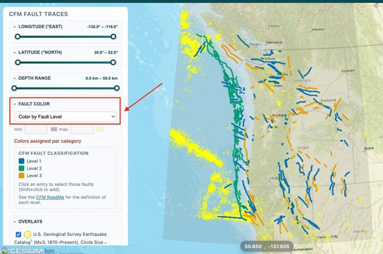

2. Click on one of the levels to select all faults of that classification. Here, all Level 1 faults are selected.
3. Click on "View 3D" and the 3D viewer will launch in a new window.

   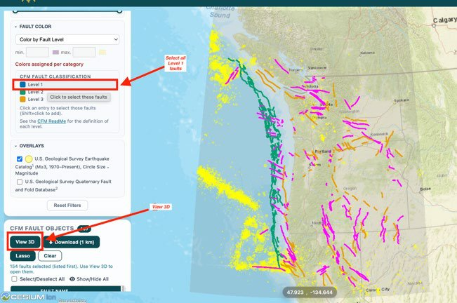

### Fault Color example 2: by region

1. Select "Color by Region".

   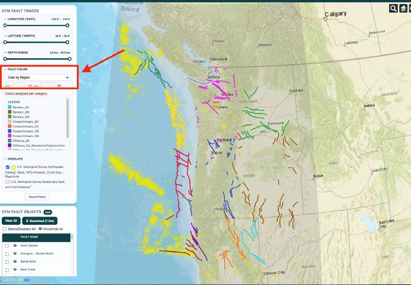

2. Use the latitude and longitude sliders to narrow the view to just the faults you would like to view.

   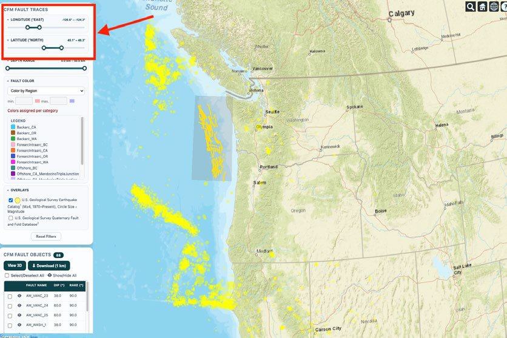

3. Click "Select/Deselect All" (you can add or remove any faults to make sure you are looking at your complete region if you had issues with the latitude/longitude sliders). Then click "View 3D". This will launch the 3D viewer with only the faults you selected.

   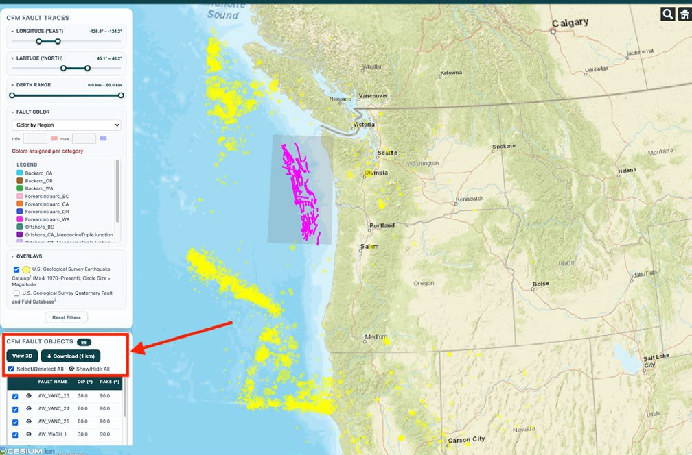

### Lasso example

1. Click on "Lasso".
2. Draw a shape around the faults you would like to select.
3. Click "View 3D" and the 3D viewer will launch in a new window.

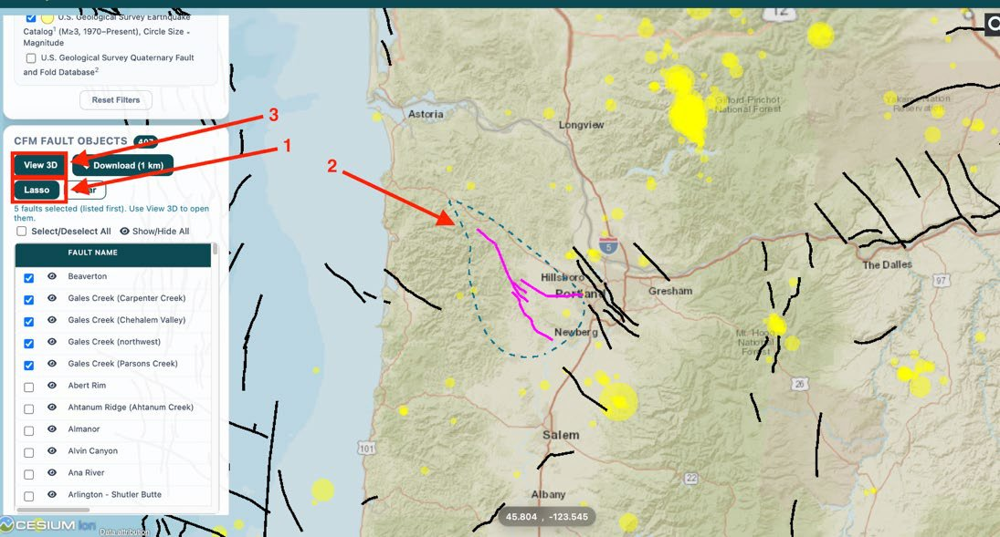

## 3D Fault Viewer

The faults load by default in a non-uniform, lower-resolution pink mesh.

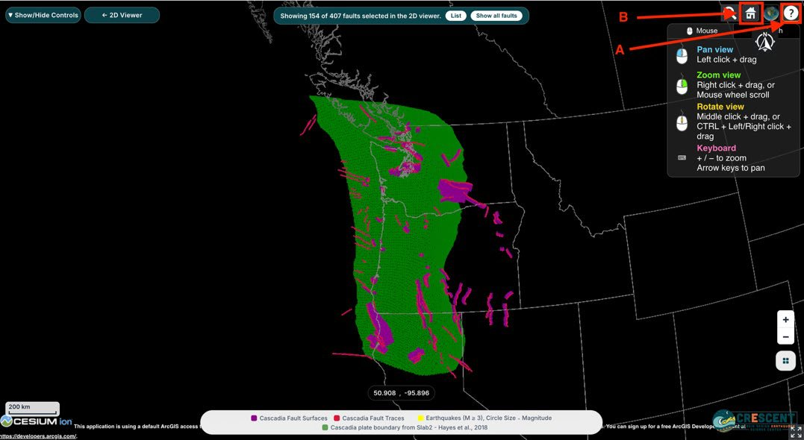

- **A.** A navigation guide for controlling the 3D viewer pops up in the upper right corner, and can be turned on and off using the "?" button in the upper right.
- **B.** Click the Home button at any time to return to this view.

The north arrow icon is movable. If it is obscuring your view at any time, you can click and drag it to a new position.

Click on a fault to see its name and attributes. If you click on "Load High-Res 1 km", a higher-resolution 1 km blue triangular mesh will replace the pink mesh.

```{list-table}
:class: borderless

* - 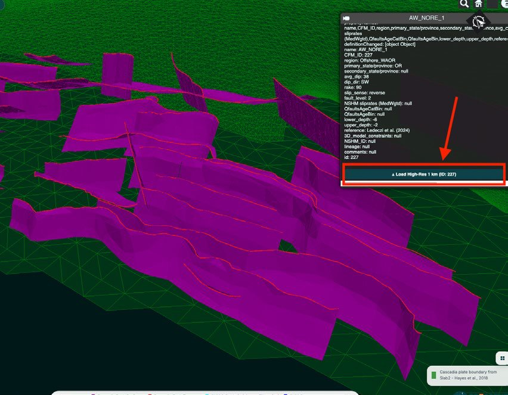
  - 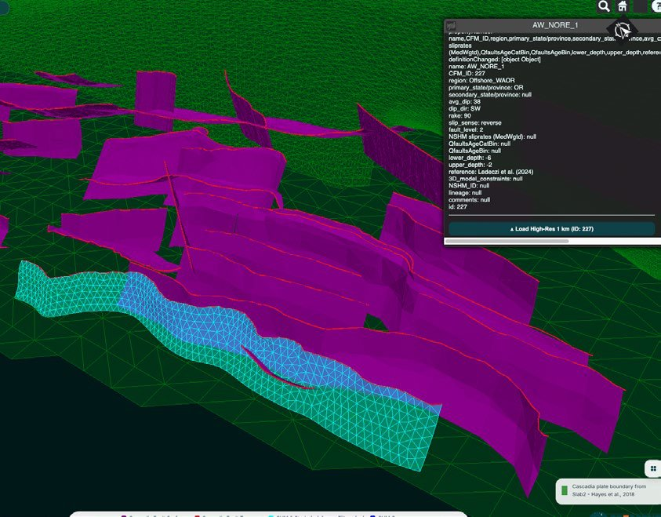
```

You can view more than one fault in high resolution at a time, but we suggest no more than 10 at a time to avoid slowing down the web viewer. Either continue selecting faults as shown above, or select multiple faults at once from a list by holding down "Shift" or "Command" and clicking multiple names from the list. This list is in a panel that can be accessed through the "Show/Hide Controls" button in the upper left. This panel is also where you can click "Reset" to set all of the faults back to the lower-resolution pink meshes. We recommend not having more than about 10 high-resolution meshes turned on at once (more can produce lag in the web viewer rendering).

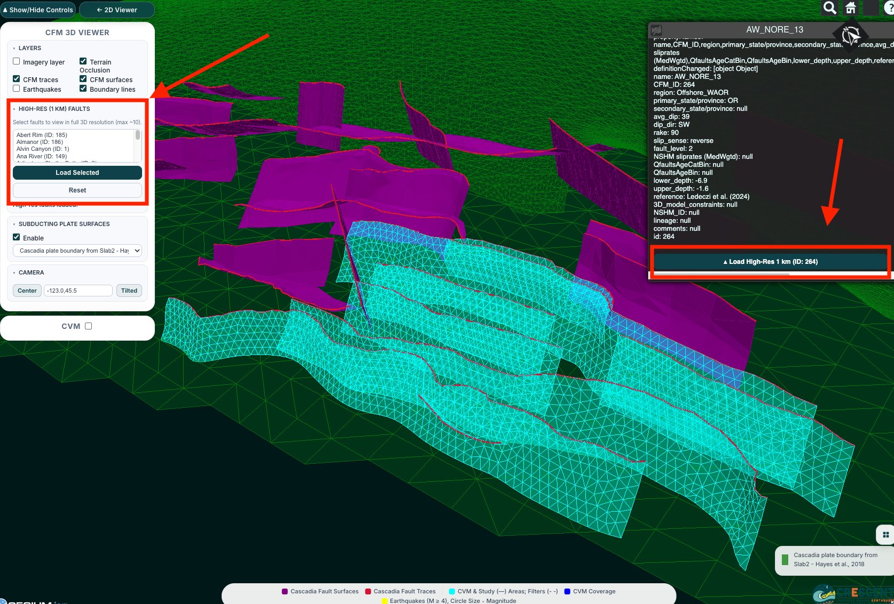

### Other useful tools in the 3D viewer

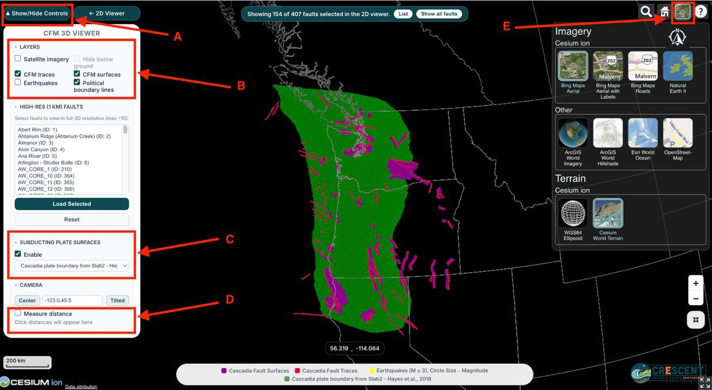

- **A.** Turn the control panel on and off.
- **B.** Turn various layers on and off, including the same earthquake catalog as in the 2D viewer, fault traces, fault 3D meshes, and imagery layers (see E below for details).
- **C.** Turn on and off and select from multiple subduction plate surface models.
- **D.** Measure 3D distances between points within the viewer.
- **E.** The square opens the options you can choose from to change the imagery layer. To first turn on imagery, select "Satellite imagery" in the left-hand panel (box B). Once this is selected, you can choose between different imagery layers in this menu on the right.

## Data Download

GeoJSON file downloads of the fault models are available on the [downloads page](https://cfm.cascadiaquakes.org/downloads). In the 2D viewer, *Download (1 km)* downloads the selected faults.

## General Tips

- Visit the **About** menu for documentation and project contacts.
- **Interaction**: Use your mouse or touchscreen to pan, zoom, and rotate the map. Hover over features to display tooltips with additional information.
- **Full-Screen Mode**: In the 3D viewer, click the full-screen icon in the bottom-right corner.
- **Legend and North Arrow**: In the 3D viewer, the legend button above the logo shows or hides the legend, and the north arrow can be dragged anywhere on screen.
- **Help and Support**: If you encounter any issues, contact the project team listed under **About**.

## Development and Branch Support

The CFM Web Interface supports configuration and deployment across multiple branches. By default, the interface uses the **main** branch. However, for development or testing purposes, the **dev** branch is also supported. To use the dev branch, access the interface with the following URL:

- `http://your-cfm-server-address/?branch=dev`

Using the **dev** branch allows you to load development-specific configuration files and resources, making it easy to test new features without affecting the main interface.

## Local Installation

If you plan to download and install this package locally:

1. Download the CFM-WEB code from the [GitHub repository](https://github.com/cascadiaquakes/CRESCENT-CFM-WEB/).
2. Download and install [Docker](https://www.docker.com/get-started/).
3. Go to the [Cesium site](https://cesium.com/ion/) and create an account and get a token.
4. Go to the downloaded CFM-WEB code directory and create a `.env` file containing `CESIUM_KEYS={"cesium_access_token": "<your token>"}`.
5. In the root directory (directory above `app/`) build the image: `docker build -t cfm_viewer .`
6. Run the package: `docker run --env-file .env -p 8080:80 cfm_viewer`
7. On your browser go to the CFM viewer at [http://localhost:8080](http://localhost:8080).

## References

- U.S. Geological Survey, FDSN Event Web Service, [earthquake.usgs.gov/fdsnws/event/1](https://earthquake.usgs.gov/fdsnws/event/1/)
- U.S. Geological Survey, Quaternary Fault and Fold Database of the United States, [earthquake.usgs.gov/cfusion/qfault](https://earthquake.usgs.gov/cfusion/qfault/query_main_AB.cfm)
